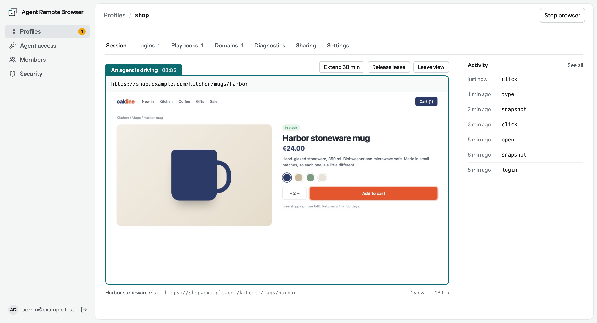
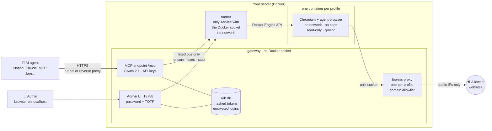

# agent-remote-browser



**Give an AI agent a real browser, without giving it your machine or your passwords.**

agent-remote-browser is a remote MCP server. An agent (a Notion Custom Agent, Claude, any MCP client) connects to it and drives a Chromium that runs on your server: open a page, read it, click, fill a form, sign in to a site. Each agent works in its own **browser profile**, a sandboxed container that keeps its cookies between sessions and can reach only the domains you allowed.

You stay in control from a small admin UI on localhost: create profiles, choose their domains, save logins, grant or revoke agent access, and watch (or take over) any browser live.

## Quick start

Requires Docker.

```sh
cp .env.example .env               # on macOS: ALLOW_NO_SANDBOX=1 (no gVisor)
mkdir -m 700 secrets && head -c 32 /dev/urandom > secrets/login_key                     # once
openssl rand -base64 48 | tr -d '\n' > secrets/better_auth_secret && chmod 600 secrets/*   # once
docker compose up -d --build       # MCP on http://localhost:18787/mcp, admin on http://localhost:18788
docker compose exec gateway node src/cli.ts admin create you@example.com   # once: password, then TOTP
```

Then open the admin UI, create a profile with its allowed domains, and connect your agent to `http://localhost:18787/mcp` (OAuth) or create an API key for it. Use the exact origin set in `PUBLIC_URL`: OAuth binds tokens to it.

## How it works



The life of one tool call, say `click`:

1. The agent calls `POST /mcp` with its token. The gateway checks the token (stored as a hash), its scope (one profile, or `global`) and the kill switch, then writes an audit line.
2. The gateway asks the **runner** to run a fixed `agent-browser` command in that profile's container. The runner is the only piece that can touch Docker, and it accepts a short list of operations, never a free command line.
3. The browser acts. Any request it makes leaves through the profile's **egress proxy**, which lets through only the allowed domains and refuses private IPs.
4. The result goes back to the agent. Page text is wrapped in `<untrusted_page_content>`, so the agent knows not to follow instructions found on a page.

## What you get

- **Isolation by default.** Each profile is its own container: no network, every capability dropped, read-only root filesystem, gVisor runtime. The only way out is the allowlisted proxy.
- **Logins the agent never sees.** Saved passwords are encrypted (AES-256-GCM, key kept outside the database). The agent's `login` tool asks the gateway to type them; the password never enters the agent's context, the admin page or a command line.
- **Standard agent auth.** OAuth 2.1 (dynamic client registration or CIMD, PKCE) for MCP clients that support it, API keys with a mandatory expiry for the others. You pick the scope on the consent page.
- **Leases.** A `global` agent can borrow a profile for a while (1 to 120 minutes, sliding); meanwhile no one else drives it.
- **Human in the loop.** Live view of every browser, with a takeover mode to click and type yourself, and fill a saved login on screen.
- **Agent asks for help.** Stuck on a captcha or a 2FA code, the agent calls `request_human` and gets a link for its user; its browser pauses until you take over and click Done. While an agent holds a lease, the live view is watch-only unless you take its request.
- **Ops basics included.** Prometheus `/metrics`, JSON logs, an audit file, restic backups, a runbook, CI with an end-to-end smoke on gVisor.

## Tools exposed to the agent

| Tool | What it does |
| --- | --- |
| `open` | Go to a URL (allowed domains only) |
| `snapshot` | Accessibility tree of the page, with element refs to act on |
| `get_text` | Visible text of the page or of one element |
| `click`, `fill` | Click or fill an element from the snapshot (never a password: see `login`) |
| `press` | Press a key (Enter, Tab, Escape…) |
| `back` | Previous page |
| `screenshot` | PNG of the viewport |
| `login` | Sign in to a site with a saved login, typed by the server |
| `request_human`, `handoff_status` | Hand the browser to a human (captcha, 2FA, consent) and wait for the outcome |
| `list_profiles`, `create_profile` | `global` scope only: see and create profiles |
| `lease_profile`, `release_profile` | `global` scope only: borrow a profile and give it back |

A token scoped to `profile:<id>` drives that profile only. A `global` token drives a profile through a lease, passed to every browser tool.

## Development

Requires Node >= 24 (target runtime: Node 26). TypeScript runs as-is, no build step.

```sh
npm ci
npm test            # unit + integration on an in-memory fake driver, no Docker needed (< 1 s)
npm run typecheck
npm run smoke       # end to end against a fresh stack
```

## Learn more

- [deploy/runbook.md](deploy/runbook.md): running it on a server (secrets, tunnel or reverse proxy, agents, backups, upgrades, uninstall).
- [docs/reference.md](docs/reference.md): deploy settings, CI, metrics, code layout, gateway and runner, database, auth details, admin API, login key, operator commands.
- [SECURITY.md](SECURITY.md): open security topics and residual risks.

Status: early, built for a single operator running their own stack. Expect breaking changes between commits; there are no versioned releases yet.

## License

[MIT](LICENSE)
